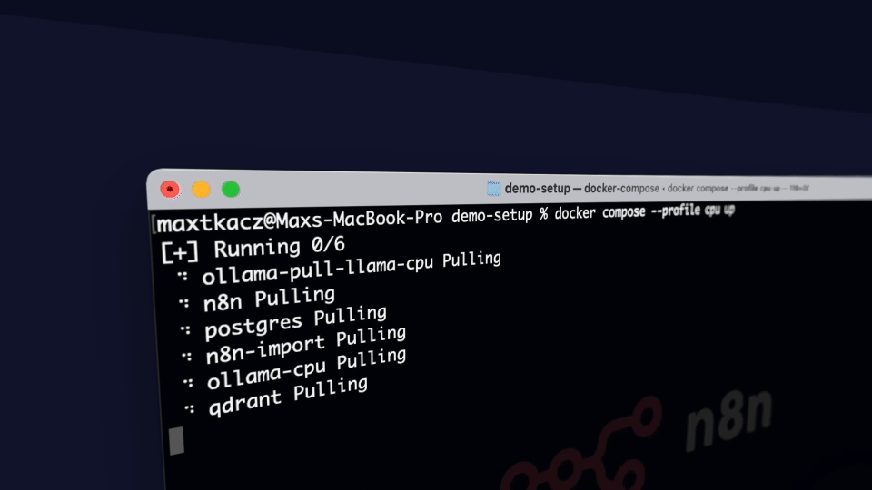

# Self-hosted AI starter kit

**Self-hosted AI Starter Kit** is a Docker Compose template that starts a
local n8n stack (n8n, PostgreSQL, task runners, Traefik with local HTTPS)
and, optionally, local AI services (vLLM, Qdrant). [Tilt](https://tilt.dev/)
orchestrates the compose projects and a small CLI (`packages/cli`) generates
the `.env` files.



### What’s included

✅ [**Self-hosted n8n**](https://n8n.io/) - Low-code platform with over 400
integrations and advanced AI components, running behind Traefik with local
HTTPS and task runners

✅ [**PostgreSQL**](https://www.postgresql.org/) - Workhorse of the Data
Engineering world, handles large amounts of data safely

✅ [**Traefik**](https://traefik.io/) - Reverse proxy with local HTTPS,
routing on `<service>.<DOMAIN>`

✅ [**Tilt**](https://tilt.dev/) - Orchestrates the Docker Compose projects

✅ [**vLLM**](https://docs.vllm.ai/) *(optional)* - High-throughput LLM
serving engine for running local models

✅ [**Ollama**](https://ollama.com/) *(optional)* - Cross-platform LLM
platform to install and run the latest local LLMs

✅ [**Qdrant**](https://qdrant.tech/) *(optional)* - Open-source, high
performance vector store with a comprehensive API

## 🛠️ Prerequisites

| Tool | Notes |
| ---- | ----- |
| Docker | Docker Desktop, OrbStack or Docker Engine with Compose v2 |
| Node.js + [pnpm](https://pnpm.io/) 10.32.1 | `npm i -g pnpm@10.32.1` |
| [Tilt](https://docs.tilt.dev/install.html) | `brew install tilt` |
| [mkcert](https://github.com/FiloSottile/mkcert) | `brew install mkcert`. Used to create the local TLS certificate for `*.dev.localhost` |
| NVIDIA Container Toolkit | Only for `AI_RUNTIME=gpu-nvidia` |

## ⚡️ Quickstart

```bash
pnpm install
pnpm build        # builds packages/cli; required before `setup`
pnpm run setup    # creates a .env next to every .env.template (never overwrites)
pnpm run config   # optional: set DOMAIN, AI_RUNTIME and N8N_VARIANT in the root .env
pnpm run dev      # tilt up
```

- On first start Tilt creates the Docker networks and, if missing, a TLS certificate in `~/.certs/dev` (`scripts/cert.sh`, using a CA in the same folder). To make your browser trust it, run `CAROOT=~/.certs/dev mkcert -install` once (needs sudo).
- n8n is available at `https://n8n.dev.localhost`. Traefik routes on `<service>.<DOMAIN>`.
- To start only some services, name them: `tilt up traefik postgres n8n n8n-runner`. Groups are `traefik`, `postgres`, `redis`, `garage` and `vault`.
- Stop and remove containers with `tilt down`.

## ⚙️ Configuration

The root `.env` is read by the `Tiltfile`:

```bash
# The domain to run the Docker Compose services on
DOMAIN=dev.localhost
# The hardware-supported AI runtime
# Options: cpu-x86-64, cpu-arm64, apple-silicon, dgx-spark, gpu-nvidia or gpu-amd
AI_RUNTIME=cpu-x86-64
# Which variant of n8n to run in ./compose/n8n
# Options: base, community or enterprise
N8N_VARIANT=base
```

`AI_RUNTIME` defaults to `cpu-x86-64`. Set it to match your hardware (`pnpm run config`) before starting the vLLM resource.

Per-project settings live in `.env` files next to each compose file, generated from `.env.template`:

- `compose/n8n/.env`: n8n version, encryption key, runner token, database credentials and `N8N_LICENSE_ACTIVATION_KEY`. Replace the template's license key with your own; n8n starts without a valid one but runs unlicensed.
- `compose/ai-models/.env`: `VLLM_VERSION` and `HF_TOKEN`, a [Hugging Face token](https://huggingface.co/settings/tokens) that is required for gated models such as Nemotron.

> [!NOTE]
> `.env` files are never committed.

## 🤖 AI models

`compose/ai-models/docker-compose.vllm-runtimes.yml` runs one vLLM model (default `Qwen/Qwen3-0.6B`, override with `VLLM_MODEL`) on the runtime selected by `AI_RUNTIME`. In Tilt, start the `vllm-<AI_RUNTIME>` resource, then:

```bash
curl localhost:8000/v1/models
```

#### For Nvidia GPU users

- `gpu-nvidia`: the same image and flags were run as a Kubernetes pod on an RTX 3090 (x86-64) and served requests. The compose file itself has not been run on a GPU host.

#### For Mac / Apple Silicon users

- `cpu-arm64` currently fails on Apple silicon with a compiler error during `torch.compile` (`sme` without `sve2`).
- `apple-silicon`: Docker on macOS cannot reach the Metal GPU, so this runtime runs Ollama natively on the host instead of in a container. Install it with `brew install ollama`, then in Tilt trigger `ollama-apple-silicon` (it reuses an Ollama that is already running) and `ollama-pull-llama-apple-silicon`. Containers reach it at `http://host.docker.internal:11434`. On an Apple M5, `llama3.2` generated about 49 tokens/s natively (100% GPU). vLLM is not used on this runtime.

#### For NVIDIA DGX Spark users

- `dgx-spark`: NVIDIA DGX Spark (arm64 Grace CPU, Blackwell GB10 GPU, unified memory). vLLM runs as `vllm-dgx-spark`: the `vllm/vllm-openai:v0.31.0` image pinned to `linux/arm64`, `memlock`/`stack` ulimits, and only `VLLM_GPU_MEM_UTIL` of the shared memory (default `0.3`, not vLLM's 0.9). That image is multi-arch and its arm64 build ships CUDA 13.0, which the GB10 needs. Ollama reuses the unchanged `ollama-gpu-nvidia` service (no Spark-specific tuning). **Not tested on a Spark**: only the compose config and the Tiltfile load were checked here, and whether the vLLM image's kernels run on the GB10 (compute capability 12.1; the image lists 12.0) and whether Ollama's container finds the GPU are unverified.

#### Embeddings

`compose/ai-models/docker-compose.vllm.yml` serves the Nemotron embedding model on an NVIDIA GPU with `--gpu-memory-utilization=0.15`. It loaded and answered `/v1/embeddings` on a 24 GiB RTX 3090 with that setting (as a Kubernetes pod with the same image and flags).

#### Ollama

`compose/ai-models/docker-compose.ollama.yml` runs Ollama on the runtime selected by `AI_RUNTIME`. In Tilt, trigger `ollama-cpu` (or `ollama-gpu-nvidia` / `ollama-gpu-amd`), then `ollama-pull-llama-cpu` (same suffix) to download `llama3.2`. The API listens on `localhost:11434`.

## 🧰 AI and secret services

Optional resources that start only when triggered in Tilt:

⭐️ `qdrant`: vector database, reachable from containers on the `n8n` network at `http://qdrant:6333`.

⭐️ `litellm-db`, then `litellm`: LiteLLM proxy at `https://litellm.<DOMAIN>`. Trigger the database first, since `litellm` waits for it.

⭐️ `vault` and `vault-unseal`: HashiCorp Vault for n8n external secrets. A fresh Vault must be initialized once; see [compose/n8n-services/vault/README.md](compose/n8n-services/vault/README.md).

## 📂 Structure

- `compose/` Docker Compose projects (proxy, n8n, n8n-data, n8n-services, ai-models, ai-services)
- `scripts/` helper scripts used by the `Tiltfile` (Docker networks, TLS certificate)
- `packages/cli` the `n8n-starter` CLI ([README](packages/cli/README.md))
- `Tiltfile` wires the compose projects together

## 👩‍💻 Development

```bash
pnpm test   # CLI unit tests
pnpm lint   # dclint on ./compose
```
